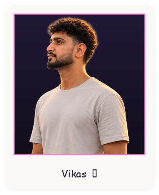
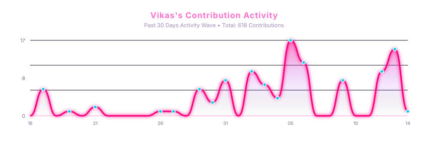
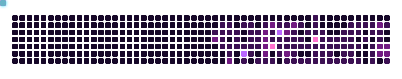

  

   

  # Hey there, I'm Vikas 👋
  ### ⚡ Full Stack Developer • Open Source Enthusiast ⚡

  

    
    
    
  

---

### 🌸 About Me

<table border="0" cellpadding="0" cellspacing="0" width="100%">
  <tr>
    <td width="65%" valign="middle">
      <ul>
        <li>💻 <b>Full Stack Developer</b> passionate about building modern web applications.</li>
         
        <li>⚡ <b>Currently learning</b> System Design, Cloud Architecture, & DevOps.</li>
         
        <li>🚀 <b>Building</b> AI-powered products and actively contributing to Open Source.</li>
         
        <li>🎯 <b>Goal</b>: Create resilient products that solve real-world problems.</li>
         
        <li>🎨 <b>Passionate about</b> backend microservices, intuitive UI, and clean code.</li>
         
        <li>✨ <i>Always chasing the next idea worth building.</i></li>
      </ul>
    </td>
    <td width="35%" align="center" valign="middle">
      
    </td>
  </tr>
</table>

---

### 💻 Tech Stack

  <table border="0">
    <tr>
      <td align="center" width="100">
         
        <b>React</b>
      </td>
      <td align="center" width="100">
         
        <b>Next.js</b>
      </td>
      <td align="center" width="100">
         
        <b>TypeScript</b>
      </td>
      <td align="center" width="100">
         
        <b>JavaScript</b>
      </td>
      <td align="center" width="100">
         
        <b>Node.js</b>
      </td>
      <td align="center" width="100">
         
        <b>Express.js</b>
      </td>
    </tr>
    <tr>
      <td align="center" width="100">
         
        <b>MongoDB</b>
      </td>
      <td align="center" width="100">
         
        <b>PostgreSQL</b>
      </td>
      <td align="center" width="100">
         
        <b>Python</b>
      </td>
      <td align="center" width="100">
         
        <b>Docker</b>
      </td>
      <td align="center" width="100">
         
        <b>CI/CD</b>
      </td>
      <td align="center" width="100">
         
        <b>Tailwind</b>
      </td>
    </tr>
  </table>

---

### 📊 GitHub Analytics

  <table border="0" width="100%">
    <tr>
      <td align="center" width="33%">
        
      </td>
      <td align="center" width="33%">
        
      </td>
      <td align="center" width="33%">
        
      </td>
    </tr>
  </table>

   

  

---

### 🐍 Contribution Graph

  

---

### 🚀 Featured Projects

- 🔹 **[Personal Developer Portfolio](https://github.com/vikas3352/personalPortfolio)**: Interactive portfolio application highlighting projects and systems.
- 🔹 **[DWPS Alwar Web Platform](https://github.com/rizeworldcode/dwpsalwar)**: Institutional portal with administrative and student management features.
- 🔹 **[Institute Rize Management](https://github.com/rizeworldcode/Institute-rize-)**: Scalable educational platform with authentication and batch tracking.
- 🔹 **[Zoniraz Jewellery](https://github.com/zonirazjewelhouse9911/zonirazjewellery)**: E-commerce platform with catalog browsing, shopping cart, and checkout.
- 🔹 **[Shine Limos](https://github.com/shinelimos9-del/shinelimos)**: Fleet reservation and scheduling web application with live dispatching.
- 🔹 **[DebugFlow](https://github.com/vikas3352)**: Intelligent error monitoring and debugging pipeline.
- 🔹 **[InterviewPAL](https://github.com/vikas3352)**: AI-driven mock interview preparation simulator.

---

### 🌐 Let's Connect

  

    
    &nbsp;
    
    &nbsp;
    
    &nbsp;
    
  

  
<b>See you in the next commit 🚀</b>

   

  

