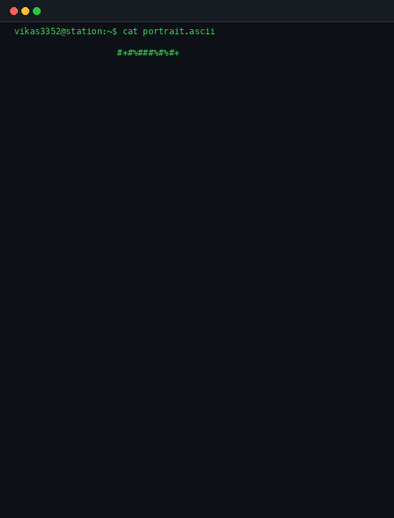

<div align="center">

# ⚡ Vikas Jangid
### Full Stack Developer • Software Engineer • Backend Developer

[](https://github.com/vikas3352)
[](https://nodejs.org/)
[](https://www.typescriptlang.org/)
[](https://react.dev/)
[](https://github.com/vikas3352)

</div>

---

## 💻 Contribution Activity Monitor

```bash
vikas@developer-station:~$ git log --graph --oneline --contributions --author="vikas3352"
```

<div align="center">
  
</div>

---

## 🖥️ Developer Identity & Terminal Station

<table border="0" cellpadding="0" cellspacing="0" width="100%">
  <tr>
    <td width="42%" align="center" valign="top">
      <!-- Animated ASCII Portrait with GIF fallback -->
      <picture>
        <source media="(prefers-color-scheme: dark)" srcset="assets/ascii-portrait.svg">
        <source media="(prefers-color-scheme: light)" srcset="assets/ascii-portrait.svg">
        
      </picture>
    </td>
    <td width="58%" align="center" valign="top">
      <!-- Neofetch Information Card -->
      
    </td>
  </tr>
</table>

---

## 🛠️ Technical Stack & Skills

```bash
vikas@developer-station:~$ sysinfo --list-stack
```

<table width="100%">
  <tr>
    <td width="20%" valign="top"><b>Core Languages</b></td>
    <td>
      
      
      
      
      
      
    </td>
  </tr>
  <tr>
    <td width="20%" valign="top"><b>Frontend</b></td>
    <td>
      
      
      
      
    </td>
  </tr>
  <tr>
    <td width="20%" valign="top"><b>Backend & APIs</b></td>
    <td>
      
      
      
      
    </td>
  </tr>
  <tr>
    <td width="20%" valign="top"><b>Databases</b></td>
    <td>
      
      
      
    </td>
  </tr>
  <tr>
    <td width="20%" valign="top"><b>DevOps & Tools</b></td>
    <td>
      
      
      
      
      
      
    </td>
  </tr>
</table>

---

## 🚀 Featured Projects & Systems

```bash
vikas@developer-station:~$ find ~/projects -type project -maxdepth 1 -exec ls -la {} +
```

### 🔹 [Personal Developer Portfolio](https://github.com/vikas3352/personalPortfolio)
Interactive developer portfolio showcasing projects, experience, and technical achievements.
- **Tech Stack**: React • JavaScript • Tailwind CSS • Responsive UI

### 🔹 [DWPS Alwar Web Platform](https://github.com/rizeworldcode/dwpsalwar)
Production institutional portal featuring student admissions, curriculum management, and administrative dashboards.
- **Tech Stack**: Full Stack • React • Node.js • Express.js • MongoDB

### 🔹 [Institute Rize Management System](https://github.com/rizeworldcode/Institute-rize-)
Scalable educational institute management platform streamlining course registration, teacher-student communication, and batch tracking.
- **Tech Stack**: React • Node.js • Express.js • Role-Based Auth

### 🔹 [Zoniraz Jewellery E-Commerce](https://github.com/zonirazjewelhouse9911/zonirazjewellery)
Modern jewelry storefront with dynamic catalog browsing, secure checkout flow, and custom inventory synchronization.
- **Tech Stack**: React • Node.js • MongoDB • Payment Gateway Integration

### 🔹 [Shine Limos Fleet Booking](https://github.com/shinelimos9-del/shinelimos)
Fleet reservation and dispatch web application with real-time route estimates, ride scheduling, and automated invoice delivery.
- **Tech Stack**: JavaScript • Node.js • Express.js • REST APIs

### 🔹 [DebugFlow](https://github.com/vikas3352)
Intelligent error tracking and debugging workflow pipeline with real-time log ingestion and root cause analysis.
- **Tech Stack**: TypeScript • Node.js • Express.js • REST APIs • CI/CD

### 🔹 [InterviewPAL](https://github.com/vikas3352)
AI-powered interview practice simulator providing real-time technical question generation and performance analytics.
- **Tech Stack**: React • TypeScript • Node.js • MongoDB

---

## 📬 Terminal Connect & Collaboration

```bash
vikas@developer-station:~$ echo "Let's build scalable systems together."
```

- **GitHub Profile**: [@vikas3352](https://github.com/vikas3352)
- **Email Contact**: [vikasjangid3352@gmail.com](mailto:vikasjangid3352@gmail.com)
- **Portfolio**: [vikas3352.github.io](https://github.com/vikas3352/personalPortfolio)
- **Location**: India • Open to Global Remote Opportunities

---

<div align="center">
  <sub>Automated daily at 06:17 UTC via GitHub Actions • Powered by Python & SVG SMIL</sub>
</div>

